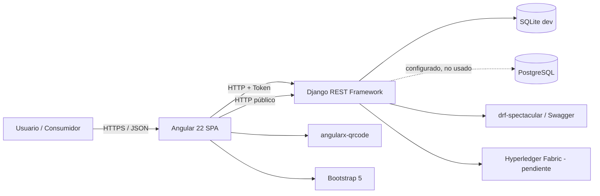
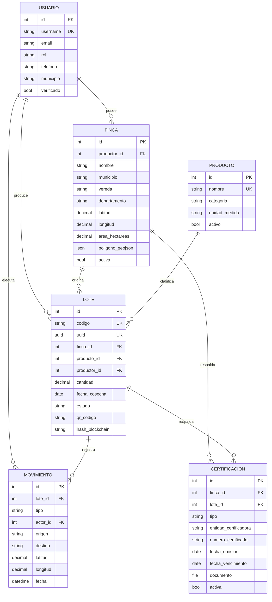

# Design: Documentación base y arquitectura actual de NariTrace

## Context

Este documento describe el sistema **tal como está implementado** en el repositorio. Acompaña al `proposal.md`, que explica por qué se documenta; aquí se registra el cómo está construido y por qué se tomaron las decisiones observadas en el código. No se modificó ningún archivo fuente.

Repositorio: dos aplicaciones independientes en el mismo árbol:

- `backend/`: Django 6.1.2 + Django REST Framework 3.18.3. Base de datos SQLite en desarrollo. Documentación OpenAPI con drf-spectacular.
- `frontend/`: Angular 22 standalone, Bootstrap 5, TypeScript 6, Vitest como runner de pruebas, `angularx-qrcode` y `ngx-echarts`.

No existe un monorepo tool, contenedor Docker, pipeline CI/CD ni archivo de despliegue.

Estado verificado al generar esta documentación:

- `ng build` finaliza correctamente (con advertencias de presupuesto y de `*ngIf` sin `CommonModule`).
- `python manage.py check` falla con `ImportError: cannot import name 'EstadisticasAdminView'`. El backend no arranca en el estado actual del árbol de trabajo.
- El cambio de documentación no corrige ese fallo; queda registrado en `tasks.md` como deuda técnica prioritaria.

## Goals / Non-Goals

**Goals:**

- Dejar una fuente de verdad legible sobre arquitectura, datos, endpoints, permisos y flujos.
- Permitir que un desarrollador o agente de IA se incorpore sin redescubrir el sistema.
- Separar con precisión lo implementado, lo parcial y lo pendiente.

**Non-Goals:**

- Corregir el backend, refactorizar, agregar endpoints o cambiar modelos.
- Definir el diseño futuro de blockchain, auditoría o despliegue.
- Sustituir la documentación generada por drf-spectacular (`/api/docs/`).

## Arquitectura general



- **Cliente:** SPA Angular con rutas públicas (`/landing`, `/login`, `/registro`, `/trazabilidad/:codigo`) y un área privada bajo `/dashboard` con rutas hijas.
- **Servidor:** API REST Django, autenticación por token, vistas `ModelViewSet` y un endpoint público adicional.
- **Persistencia:** SQLite (`backend/db.sqlite3`). `psycopg2-binary` está en `requirements.txt` y `DATABASE_URL` aparece en `.env.example`, pero `settings.py` ignora esa variable y fija SQLite.
- **Documentación de API:** `/api/schema/`, `/api/docs/` (Swagger UI) y `/api/redoc/`.

## Organización de carpetas

```
naritrace/
├── backend/
│   ├── manage.py
│   ├── requirements.txt
│   ├── .env / .env.example
│   ├── db.sqlite3                  # datos de ejemplo (ignorado por git)
│   ├── naritrace/                  # proyecto Django
│   │   ├── settings.py
│   │   ├── urls.py
│   │   ├── asgi.py / wsgi.py
│   ├── usuarios/                   # usuario custom, registro, admin
│   │   ├── models.py
│   │   ├── serializers.py
│   │   ├── views.py
│   │   ├── urls.py
│   │   ├── admin.py
│   │   └── migrations/0001_initial.py
│   ├── trazabilidad/               # dominio principal
│   │   ├── models.py               # Producto, Finca, Lote, Movimiento, Certificacion
│   │   ├── serializers.py
│   │   ├── views.py
│   │   ├── urls.py
│   │   ├── admin.py
│   │   └── migrations/0001_initial.py
│   ├── blockchain/                 # app instalada, sin implementación
│   └── auditoria/                  # app instalada, sin implementación
├── frontend/
│   ├── angular.json                # Bootstrap incluido en styles
│   ├── package.json
│   ├── src/
│   │   ├── main.ts
│   │   ├── index.html
│   │   ├── styles.css              # vacío
│   │   └── app/
│   │       ├── app.ts / app.config.ts / app.routes.ts
│   │       ├── services/api.ts
│   │       └── components/
│   │           ├── landing/
│   │           ├── login/
│   │           ├── registro/
│   │           ├── dashboard/          # layout con sidebar y router-outlet
│   │           ├── lista-lotes/
│   │           ├── crear-lote/
│   │           ├── detalle-lote/
│   │           ├── lista-fincas/
│   │           ├── crear-finca/
│   │           ├── trazabilidad-publica/
│   │           └── admin-panel/        # sin seguimiento en git (untracked)
│   ├── public/favicon.ico
│   └── README.md                   # README genérico de Angular CLI
├── docs/wireframes/                # vacío
├── openspec/                       # esta documentación
└── README.md                       # descripción del producto y stack
```

Convenciones observadas:

- Componentes Angular **standalone**, sin `NgModule`.
- Algunos componentes usan `template` inline (`dashboard`, `landing`, `lista-lotes`, `lista-fincas`, `trazabilidad-publica`, `admin-panel`) y conservan un `.html` de plantilla generada que **no se usa** (`<p>... works!</p>`).
- Vistas Django por clases (`generics.CreateAPIView`, `viewsets.ModelViewSet`, `viewsets.ViewSet`).
- Serializers separados por caso de uso (lista, detalle, público).

## Componentes principales

### Backend

| Componente | Responsabilidad | Archivo |
|---|---|---|
| `Usuario` | Usuario custom con rol, teléfono, municipio y verificación | `usuarios/models.py` |
| `RegistroView` | Alta pública de usuarios | `usuarios/views.py` |
| `ProductoViewSet` | CRUD y filtros del catálogo | `trazabilidad/views.py` |
| `FincaViewSet` | CRUD de fincas y filtrado por productor | `trazabilidad/views.py` |
| `LoteViewSet` | CRUD, filtros, publicación y búsqueda por código | `trazabilidad/views.py` |
| `MovimientoViewSet` | CRUD de eventos; actor automático | `trazabilidad/views.py` |
| `CertificacionViewSet` | CRUD de certificaciones | `trazabilidad/views.py` |
| `TrazabilidadPublicaViewSet` | Consulta pública por código | `trazabilidad/views.py` |
| `EstadisticasAdminView` | **No existe**; referenciada por `trazabilidad/urls.py` | — |

### Frontend

| Componente | Ruta | Responsabilidad |
|---|---|---|
| `LandingComponent` | `/landing` | Presentación del producto y acceso a login/registro; contiene un buscador de código no visible en la plantilla |
| `LoginComponent` | `/login` | Formulario reactivo; guarda token y navega al dashboard |
| `RegistroComponent` | `/registro` | Alta de productor/distribuidor; transforma el formulario al contrato del backend |
| `DashboardComponent` | `/dashboard` | Layout con sidebar, navegación y cierre de sesión |
| `ListaLotesComponent` | `/dashboard/lotes` | Tarjetas de lotes paginados |
| `CrearLoteComponent` | `/dashboard/lotes/nuevo` | Formulario de alta de lote |
| `DetalleLoteComponent` | `/dashboard/lotes/:id` | Datos, QR, publicación y alta de movimientos |
| `ListaFincasComponent` | `/dashboard/fincas` | Tarjetas de fincas |
| `CrearFincaComponent` | `/dashboard/fincas/nueva` | Formulario de alta de finca |
| `TrazabilidadPublicaComponent` | `/trazabilidad/:codigo` | Ficha pública con línea de tiempo |
| `AdminPanelComponent` | `/dashboard/admin` | Tarjetas y listado de estadísticas; depende del endpoint faltante |
| `ApiService` | — | Cliente HTTP central; URL fija y token en `localStorage` |

### Flujos principales

1. **Registro e inicio de sesión**: `/registro` → `POST /api/usuarios/registro/` → `/login` → `POST /api/token/` → token en `localStorage` → `/dashboard/lotes`.
2. **Alta de finca**: `/dashboard/fincas/nueva` → `POST /api/fincas/` → listado de fincas.
3. **Alta y publicación de lote**: `/dashboard/lotes/nuevo` → `POST /api/lotes/` (código y QR automáticos, estado `borrador`) → detalle → `POST /api/lotes/{id}/publicar/`.
4. **Eventos**: detalle del lote → `POST /api/movimientos/` → recarga del historial.
5. **Consulta del consumidor**: QR con URL `/trazabilidad/<codigo>` → `GET /api/publico/trazabilidad/<codigo>/` → ficha pública.
6. **Administración**: Django Admin en `/admin/` para todos los modelos; el panel Angular de estadísticas está incompleto.

## Modelo de datos



Reglas y restricciones verificadas:

- `Usuario` extiende `AbstractUser`; `AUTH_USER_MODEL = 'usuarios.Usuario'`.
- `Lote.codigo` y `Lote.uuid` son únicos y no editables; se generan en `Lote.save()`.
- `Lote.finca`, `Lote.producto` y `Lote.productor` usan `on_delete=PROTECT`.
- `Finca.productor` y `Movimiento.lote` usan `CASCADE`; `Movimiento.actor` usa `PROTECT`.
- `Certificacion.finca` y `Certificacion.lote` son ambos opcionales y usan `CASCADE`.
- `Lote.cantidad` tiene `MinValueValidator(0)`; no hay validación de unicidad de certificados.
- No hay índices explícitos adicionales ni restricciones de base de datos para coordenadas o GeoJSON.

## API REST observada

Prefijo global `http://127.0.0.1:8000/api/` (el frontend lo fija en `ApiService`).

| Método | Ruta | Autenticación | Descripción |
|---|---|---|---|
| POST | `/token/` | Pública | Obtiene token |
| POST | `/usuarios/registro/` | Pública | Registro de usuario |
| GET/POST | `/productos/` | Lectura pública; escritura autenticada | Catálogo |
| GET/PUT/PATCH/DELETE | `/productos/{id}/` | Lectura pública; escritura autenticada | Producto |
| GET/POST | `/fincas/` | Lectura pública; escritura autenticada | Fincas |
| GET/PUT/PATCH/DELETE | `/fincas/{id}/` | Lectura pública; escritura autenticada | Finca |
| GET/POST | `/lotes/` | Lectura pública; escritura autenticada | Lotes |
| GET/PUT/PATCH/DELETE | `/lotes/{id}/` | Lectura pública; escritura autenticada | Lote |
| POST | `/lotes/{id}/publicar/` | Autenticada | Publicar lote en borrador |
| GET | `/lotes/por-codigo/{codigo}/` | Pública | Lote publicado por código |
| GET/POST | `/movimientos/` | Lectura pública; escritura autenticada | Movimientos |
| GET/PUT/PATCH/DELETE | `/movimientos/{id}/` | Lectura pública; escritura autenticada | Movimiento |
| GET/POST | `/certificaciones/` | Lectura pública; escritura autenticada | Certificaciones |
| GET/PUT/PATCH/DELETE | `/certificaciones/{id}/` | Lectura pública; escritura autenticada | Certificación |
| GET | `/publico/trazabilidad/{codigo}/` | Pública | Ficha pública |
| GET | `/estadisticas/` | — | **Roto**: la vista no existe |
| GET | `/schema/`, `/docs/`, `/redoc/` | Pública | OpenAPI y documentación |
| — | `/admin/` | Sesión staff | Django Admin |

Parámetros de consulta implementados: `categoria` y `search` en productos; `municipio` en fincas; `estado`, `producto`, `finca` y `search` en lotes; `lote` en movimientos; `finca` y `lote` en certificaciones. Paginación global de 20.

## Autenticación y autorización

- **Autenticación:** `TokenAuthentication` y `SessionAuthentication`; token emitido por `rest_framework.authtoken`.
- **Permiso global:** `IsAuthenticatedOrReadOnly`, con `AllowAny` en registro y consulta pública.
- **Autorización por rol:** solo se aplica en `FincaViewSet` y `LoteViewSet`, filtrando el queryset cuando `user.rol == 'productor'` y asignando el productor al crear.
- **Frontend:** no hay `HttpInterceptor`, `AuthGuard` ni servicio de sesión; el token se lee de `localStorage` en cada llamada. El rol se intenta leer de `localStorage` (`getUserRole`) pero nunca se guarda (`setUserRole` no se invoca).

Brechas verificadas:

- Cualquier usuario autenticado puede crear, editar o eliminar lotes, fincas, movimientos y certificaciones de otros; no hay comprobación de propiedad en `update`/`destroy`.
- Cualquier usuario autenticado puede registrar movimientos en cualquier lote.
- Los endpoints de listado y detalle permiten lectura anónima de lotes en `borrador` y de datos de contacto no expuestos por la ficha pública.
- El registro está abierto y no verifica correo; `verificado` solo se cambia manualmente desde el admin.
- La UI de registro ofrece el rol `distribuidor`, que no existe en el modelo (las opciones son `productor`, `acopiador`, `transportador`, `administrador`, `cliente`). El backend rechazará ese registro.
- El enlace "Panel Admin" del sidebar depende de `rol`, variable no definida en `DashboardComponent`; nunca se muestra.

## Decisiones arquitectónicas identificadas

| Decisión | Evidencia | Consecuencia |
|---|---|---|
| Django + DRF en lugar de un framework minimalista | `requirements.txt`, `settings.py` | Admin, ORM y autenticación listos; acoplamiento al ecosistema Django |
| Usuario custom desde el inicio | `AUTH_USER_MODEL` y migración inicial | Permite roles y campos propios sin migración destructiva posterior |
| Token auth en lugar de JWT/sesión | `DEFAULT_AUTHENTICATION_CLASSES` | Simple; sin expiración ni refresh; token en `localStorage` |
| SQLite en desarrollo pese a PostgreSQL previsto | `DATABASES` fija SQLite; `DATABASE_URL` sin usar | Arranque simple; diferencia respecto a producción |
| Código de lote derivado del UUID en `save()` | `Lote.save()` | Código legible y estable; lógica de negocio en el modelo |
| `qr_codigo` como URL del frontend hardcodeada | `http://localhost:4200/trazabilidad/...` | Funciona en local; no es configurable por entorno |
| Separar serializer público del privado | `TrazabilidadPublicaSerializer` | Minimiza datos expuestos en la ficha pública, aunque los endpoints CRUD siguen abiertos a lectura |
| Frontend standalone con Bootstrap | `app.config.ts`, `angular.json` | Menos boilerplate; estilos globales mínimos |
| Sin capa de estado ni interceptores | `ApiService` y componentes | Bajo acoplamiento; duplicación de llamadas y `ChangeDetectorRef` manual |
| Apps `blockchain` y `auditoria` creadas pero vacías | `models.py`/`views.py` sin contenido | Reservan el dominio; no hay funcionalidad real |
| `hash_blockchain` como campo reservado | Modelos `Lote` y `Movimiento` | Preparado para integración futura; hoy siempre vacío |

## Integraciones y dependencias

**Backend (`requirements.txt`):** Django 6.1.2, djangorestframework 3.18.3, django-cors-headers 4.9.0, drf-spectacular 0.30.0, psycopg2-binary 9.2.13, python-decouple 3.8, PyYAML, jsonschema. No hay SDK de Hyperledger Fabric, Celery, Redis ni almacenamiento externo.

**Frontend (`package.json`):** Angular 22.1, RxJS 7.8, Bootstrap 5.3, `angularx-qrcode` 22, `echarts` 6 + `ngx-echarts` 22 (proveídos en `app.config.ts` pero sin uso visible), Vitest 4 y jsdom para pruebas.

**Integraciones externas reales:** ninguna. Las imágenes de landing/login/registro se cargan desde Unsplash por URL. Hyperledger Fabric, Leaflet/GeoJSON y PostgreSQL aparecen en el README como stack previsto, pero no están integrados en el código (Leaflet no está en `package.json`; el polígono solo se almacena como JSON).

**Configuración:** `python-decouple` lee `SECRET_KEY`, `DEBUG`, `ALLOWED_HOSTS` y `CORS_ALLOWED_ORIGINS` desde `backend/.env`. CORS permite por defecto `http://localhost:4200`. No hay archivos de entorno en Angular.

## Riesgos / Trade-offs

| Riesgo | Impacto | Mitigación propuesta (no implementada) |
|---|---|---|
| `EstadisticasAdminView` inexistente | El backend no inicia; toda la API queda caída | Implementar la vista o retirar la ruta antes de continuar |
| Sin pruebas automatizadas | Regresiones silenciosas; los specs generados importan clases inexistentes | Corregir imports y escribir pruebas de API y componentes |
| Autorización solo por queryset | Un autenticado puede modificar recursos ajenos | Permisos por objeto y validación de propiedad |
| Lectura anónima de borradores y datos de fincas | Exposición de información no publicada | Permisos de lectura por estado y serializers públicos en todos los listados |
| URL de QR y API hardcodeadas | Imposible desplegar en otro host sin editar código | Variables de entorno de Angular y `reverse`/setting en backend |
| Rol no persistido en el cliente | El panel admin nunca aparece; no hay navegación por rol | Devolver perfil en login o endpoint `/me` y guardar rol |
| Rol `distribuidor` en la UI | Registro rechazado por el backend | Alinear opciones de UI con `Usuario.Rol` |
| SQLite en desarrollo y PostgreSQL previsto | Diferencias de comportamiento y migración pendiente | Configurar `DATABASE_URL` con `dj-database-url` o similar |
| `hash_blockchain` vacío | La promesa de inmutabilidad no se cumple | Integrar Fabric y calcular/verificar hash |
| Apps `blockchain` y `auditoria` vacías | Falsa impresión de funcionalidad | Documentar como pendiente y no anunciarlas como disponibles |
| `MAILERS` apunta al backend de consola | No hay envío real de correo, verificación ni notificaciones | Configurar un mailer SMTP real en `MAILERS` y el flujo de verificación |

## Migration Plan

Este cambio no modifica datos ni código, por lo que no requiere migración. Para dejar el sistema ejecutable:

1. Resolver el `ImportError` de `trazabilidad/urls.py`.
2. Ejecutar `python manage.py migrate` y `python manage.py runserver` en `backend/`.
3. Ejecutar `npm install` y `npm start` en `frontend/`.
4. Verificar `/api/docs/` y las rutas del frontend.

Los pasos anteriores son verificación operativa, no parte de este cambio documental.

## Open Questions

- ¿La vista de estadísticas se implementará en backend o se eliminará del frontend?
- ¿El rol `distribuidor` debe agregarse al modelo o la UI debe limitarse a los roles existentes?
- ¿La lectura pública de fincas y lotes en borrador es intencional?
- ¿Qué cadena de Hyperledger Fabric y qué contrato inteligente se usarán?
- ¿PostgreSQL será el motor de producción y con qué estrategia de migración?
- ¿Se requiere verificación de correo o aprobación de productores antes de publicar?
